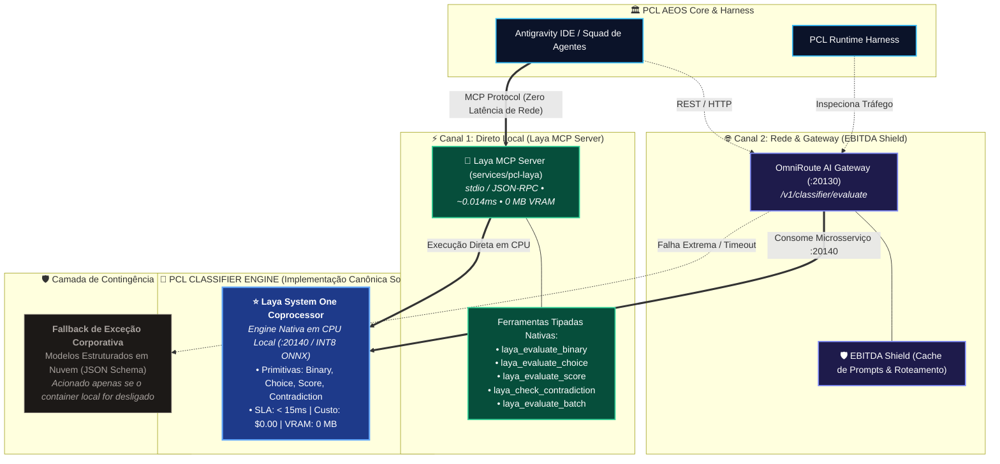

# SPEC-PCL-AEOS-CLASSIFIER-01: PCL Triage & System 1 Classifier Engine Specification

**Versão:** 2.0-Sovereign (Laya System One)  
**Status:** Approved & Implemented (Ports & Adapters Architecture / Laya MCP Native)  
**Autor:** Forward Deployed Architecture (FDA) / PCL AI Squad  
**Escopo:** OmniRoute AI Gateway (:20130), Antigravity IDE, PCL Core Engine, Laya MCP Server  
**Padrão Arquitetural:** Hexagonal Architecture (Ports & Adapters) / Strategy Pattern  
**Normas de Governança:** ISO/IEC 27001 & ISO/IEC 42001  

---

## 1. Diretriz Arquitetural: Abstração & Soberania do Sistema 1

Para garantir que o **PCL AEOS** opere como um Sistema Operacional de IA Soberano, o componente de decisão e triagem ultrarrápida é formalizado como o **PCL Classifier Engine**, implementado nativamente pelo **Coprocessador Laya System One**.

A arquitetura do AEOS opera em modelo de portas e adaptadores, permitindo comunicação direta local em altíssima velocidade via **Model Context Protocol (MCP)** e exposição em microsserviço no container do **OmniRoute AI Gateway (:20130)** para blindagem financeira (*EBITDA Shield*).



---

## 2. Contrato da Interface Abstrata (`PCL Classifier Port`)

Qualquer provedor de classificação integrado ao PCL AEOS implementa rigorosamente as quatro primitivas determinísticas abaixo:

1. **`evaluate_binary(state, query) -> { result: boolean, confidence: float }`**
   - Respostas estritas de sim/não ou verdadeiro/falso sem geração de texto.
2. **`evaluate_choice(state, query, options[]) -> { selected: string, confidence: float }`**
   - Seleção determinística dentre uma lista fixa de opções.
3. **`evaluate_score(state, query, min, max) -> { score: float, confidence: float }`**
   - Atribuição de pontuação numérica dentro de um intervalo calibrado.
4. **`check_contradiction(premise, hypothesis) -> { contradiction: boolean, confidence: float }`**
   - Verificação instantânea de conflito ou staleness entre premissas documentais e afirmações.

### Requisitos Inegociáveis do Motor
- **Latência:** Resposta entre **0.014ms (via MCP local) e < 35ms (via REST Docker)**.
- **Segurança de Tipos (Type Safety):** Garantia absoluta de conformidade ao schema JSON, eliminando quebras de pipeline e alucinações de texto.
- **EBITDA Shield / Economia de Tokens:** Isenção total de cobrança de tokens de saída (*zero output token generation*, custo \$0.00).
- **Consumo de Hardware:** 0 MB de VRAM na GPU; execução 100% em CPU com quantização INT8.

---

## 3. Mapeamento de Provedores (Adapters)

### **3.1. Provedor Canônico Soberano: Laya System One Coprocessor**
- **Descrição:** Motor do Sistema 1 local treinado e calibrado para decisões reflexas ultrarrápidas, sem dependência de nuvem.
- **Caso de Uso no AEOS:** Triagem primária de prompts no Antigravity IDE, verificação instantânea de contradições no RAG de memória, classificação de intenções em microssegundos e guardrails pré-execução no pipeline TLC.
- **Interfaces:**
  - **Canal Local:** MCP Server (`services/pcl-laya/src/mcp_server.py`) via `stdio`.
  - **Canal de Rede:** Endpoint HTTP REST no container `pcl-laya:20140`.
- **Custo:** \$0.00 / 0 MB GPU VRAM / 100% Offline.

### **3.2. Provedor Alternativo de Borda: Local Compiled ONNX Runtime**
- **Descrição:** Classificador embarcado compilado para ambientes bare-metal de baixíssimo consumo energético.
- **Caso de Uso:** Ambiência de borda com *air-gap* total ou requisitos de hardware ultrarrestringido.

### **3.3. Provedor de Contingência: Cloud Structured Fallback**
- **Descrição:** Adaptador para saídas estruturadas via Amazon Bedrock, Google Vertex AI ou OpenAI Structured Outputs (JSON Schema estrito).
- **Caso de Uso:** Fallback secundário ativado apenas na hipótese de parada deliberada dos serviços locais.

---

## 4. Configuração no OmniRoute AI Gateway (:20130)

O OmniRoute gerencia a integração dinâmica com o Laya através de variáveis de ambiente no `docker-compose.aeos.yml`:

```yaml
# Trecho de configuração no OmniRoute Gateway
OMNIROUTE_CLASSIFIER_PROVIDER: "laya"
OMNIROUTE_LAYA_ENDPOINT: "http://pcl-laya:20140"
OMNIROUTE_CLASSIFIER_FAILOVER_ENABLED: "true"
```

---

## 5. Integração com Antigravity IDE & Agentes

1. O **Antigravity IDE** acessa diretamente o Laya MCP Server registrado em `.agents/mcp_config.json`, garantindo decisão instantânea em CPU antes de qualquer inferência de modelo pesado.
2. O **OmniRoute Gateway** consome o Laya na porta `:20140` como firewall semântico e protetor de custos (*EBITDA Shield*).
