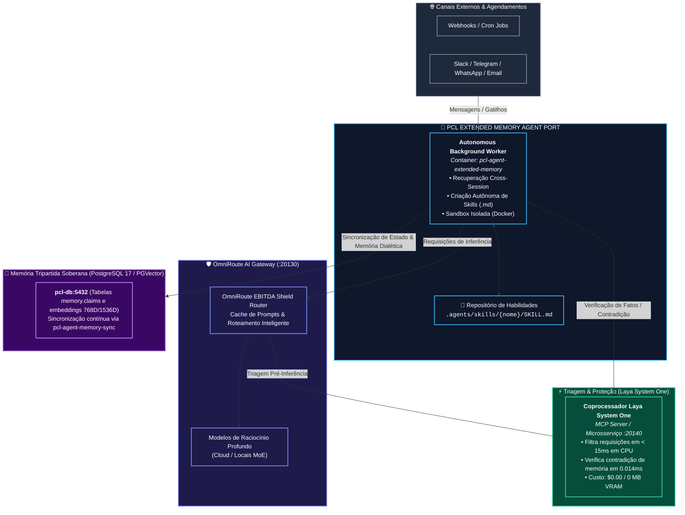

# SPEC-PCL-AEOS-AGENT-02: PCL Extended Memory & Autonomous Background Agent Specification

**Versão:** 2.0-Sovereign (Laya System One & Tripartite Memory)  
**Status:** Approved for Implementation (Ports & Adapters Architecture)  
**Autor:** Forward Deployed Architecture (FDA) / PCL AI Squad  
**Escopo:** PCL AEOS Engine, OmniRoute AI Gateway (:20130), Antigravity IDE, Laya MCP Server  
**Padrão Arquitetural:** Hexagonal Architecture (Ports & Adapters)  
**Normas de Governança:** ISO/IEC 27001 & ISO/IEC 42001  

---

## 1. Visão Geral e Arquitetura Hexagonal de Agentes

O **PCL AEOS** opera um subsistema autônomo de segundo plano (*background daemon*) para **assistência contínua, memória estendida persistente e criação dinâmica de habilidades (skills)**.

Para garantir soberania, modularidade e desacoplamento de ferramentas proprietárias, este componente é formalizado sob o contrato do **`PCL Extended Memory Agent Port`**.

---

## 2. Requisitos do Porto `PCL Extended Memory Agent`

Qualquer mecanismo de agente de plano de fundo integrado ao AEOS deve obrigatoriamente satisfazer os seguintes pilares:

1. **Memória Persistente Dialética:** Armazenar e recuperar preferências, fatos e decisões históricas de sessões passadas sem inflar o contexto das chamadas ativas, validando contradições através do Coprocessador Laya (`laya_check_contradiction`).
2. **Criação e Execução de Habilidades Portáveis (`SKILL.md`):** Consolidar soluções de problemas complexos em arquivos de habilidades reutilizáveis no formato padronizado markdown (`SKILL.md`), armazenados em `.agents/skills/`.
3. **Gateway Multicanal Desvinculado:** Suporte a canais de mensagens assíncronas (Slack, Telegram, WhatsApp, Email ou Webhook) com controle perimetral Zero Trust via Tailscale.
4. **Isolamento de Execução (Sandbox):** Execução de código e comandos em ambiente isolado (Docker / Sandbox) para prevenção de vazamento de credenciais e elevação de privilégios.

---

## 3. Mapeamento de Provedores (Adapters)

### **3.1. Provedor Padrão (Reference Implementation): Hermes Agent Runtime**
- **Serviço no Docker:** `pcl-agent-extended-memory` (executando o runtime open-source Hermes Agent).
- **Justificativa de Escolha:** Motor em Python 3.12 com memória SQLite/FTS5 local, suporte nativo a múltiplos canais de comunicação, criação autônoma de `SKILL.md` e licença MIT aberta.
- **Roteamento de Inferência & Laya Shield:** Todas as chamadas do agente para modelos de linguagem passam obrigatoriamente pelo **OmniRoute Gateway (:20130)** e pelo **Laya System One**, garantindo triagem de intenções em milissegundos e custo zero de tokens em consultas repetidas.

### **3.2. Provedor Alternativo A: OpenClaw / Custom Background Worker**
- **Serviço no Docker:** `pcl-agent-extended-memory` (executando o agente OpenClaw ou daemon interno do PCL Cortex Engine).
- **Caso de Uso:** Projetos onde a governança do cliente exige substituição do runtime por um motor desenvolvido internamente.

### **3.3. Provedor Alternativo B: Managed Cloud Agent (Amazon Bedrock / Google Vertex)**
- **Caso de Uso:** Implantações corporativas onde o cliente exige a utilização de agentes gerenciados na infraestrutura de nuvem pública contratada.

---

## 4. Ponte de Sincronização & Governança (ISO 27001 / ISO 42001)

Independente do provedor de agente utilizado no container `pcl-agent-extended-memory`:

1. **Sincronização de Memória com PGVector:** O serviço `pcl-agent-memory-sync` extrai os dados do banco local do agente e sincroniza na **Memória Tripartida no PostgreSQL 17/PGVector** (`pcl-db:5432`).
2. **Governança de Habilidades (TLC v3 Stage Gate 4):** Toda nova habilidade criada autonomamente pelo agente é copiada para o diretório `.agents/skills/` do Antigravity IDE e submetida à auditoria de testes do **Stage Gate 4 (Validate)** antes da promoção final.
